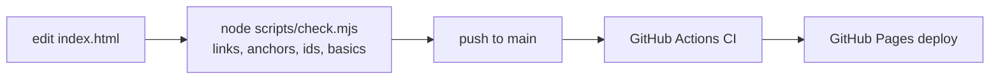

# Portfolio website


A single-page dark portfolio for a functional safety and robotics job search. It presents four public learning projects with their headline numbers, the standards being studied, and a clear line between what is used and what is still being learned.

There is no framework, no build step and no dependencies. The whole site is one HTML file, one stylesheet and one script, so it loads fast and cannot break on an `npm install`.

> **Content note.** Every project on the page is a learning project or simulation, and the page says so. Numbers are copied from each project's own README, including the ones that come from assumed models.

## Contents

- [What it does](#what-it-does)
- [Quick start](#quick-start)
- [How it works](#how-it-works)
- [Repository layout](#repository-layout)
- [Editing the content](#editing-the-content)
- [Deploying](#deploying)
- [Limitations](#limitations)
- [Next steps](#next-steps)
- [License](#license)



## What it does

| Feature | Detail |
|---|---|
| Dark theme | Near-black background, violet accent with amber and red, the last two borrowed from safety-zone colours |
| Hero | Dot grid that reacts to the cursor, plus pulsing zone rings (violet, amber, red) |
| Scroll | Reveal on scroll, progress bar, active nav link, count-up numbers |
| Cards | Cursor spotlight and a very small 3D tilt on devices with a mouse |
| Safety-zone demo | A toy model of speed and separation monitoring: move a "person" marker towards a robot arm and it slows, then stops. Works with mouse, touch drag and arrow keys |
| Cursor extras | A soft light that follows the mouse, and buttons that lean towards it (mouse only) |
| Accessibility | Skip link, semantic landmarks, visible focus, real HTML text, keyboard friendly; the demo announces state changes to screen readers |
| Reduced motion | `prefers-reduced-motion` turns off the canvas, tilt, reveals, count-up, glow and the arm's swing |
| Performance | No libraries; canvases pause when off screen or when the tab is hidden |

## Quick start

```powershell
git clone https://github.com/Madmaxcoder2612/portfolio
cd portfolio
python -m http.server 5173
```

Open <http://127.0.0.1:5173>. Opening `index.html` straight from disk also works in most browsers.

Run the checks (needs Node 18 or newer, nothing to install):

```powershell
node scripts/check.mjs
node --check assets/main.js
```

## How it works

| File | What it does |
|---|---|
| `index.html` | All content and structure |
| `assets/style.css` | Design tokens (colours, fonts), layout, responsive rules, reduced-motion rules |
| `assets/main.js` | Scroll reveal, nav state, count-up, card spotlight and tilt, hero canvas |
| `assets/favicon.svg` | Icon: three concentric zones |
| `scripts/check.mjs` | Fails if a link or anchor is broken, an id repeats, an image lacks alt text, an external link lacks `rel="noopener"`, placeholder text is left, or the footer lacks the full legal name |
| `.github/workflows/ci.yml` | Runs the checks on every push and pull request, then deploys `main` to GitHub Pages |

## Repository layout

```text
.
├── index.html
├── assets/
│   ├── style.css
│   ├── main.js
│   └── favicon.svg
├── scripts/
│   └── check.mjs
├── .github/workflows/ci.yml
├── LICENSE
└── README.md
```

## Editing the content

- **Add a project:** copy an `<article class="card reveal" data-tilt>` block in the Projects section and change the text, numbers and link.
- **Change colours:** edit the variables at the top of `assets/style.css`.
- **Add a link (for example an email or a new profile):** add an `<a class="btn" href="..." rel="noopener">` in the Contact section. The check script enforces `rel="noopener"` on external links.

## Deploying

The workflow publishes to GitHub Pages. Once, in the repository settings, set **Pages → Build and deployment → Source** to **GitHub Actions**. After that every push to `main` that passes the checks goes live.

## Limitations

- **Fonts load from Google Fonts.** Offline, or if blocked, the page falls back to system fonts and still works.
- **The checks are structural.** They catch broken links and missing basics, not bad wording or a layout that looks wrong. I checked the visual result by hand in one browser.
- **Project numbers are copied by hand** from the other READMEs. If a project changes, this page can fall out of date.
- **The email address is public on the page** as a plain mailto link, so it can be picked up by spam scrapers. There is no contact form.
- **The safety-zone demo is a picture, not a model.** The zone sizes and the 1.5 m scale are made up for illustration and are not calculated from a stopping-distance analysis; the page says so next to the demo.
- **The 3D effect is deliberately light.** A cursor-driven tilt and zone rings, not a WebGL scene, to keep it fast on phones and low-power laptops.

## Next steps

- Add the real-hardware quantum run and any new project cards as they ship.
- Add a short "what I'd do differently" note under each project.
- Add a custom domain.

## License

MIT, see [LICENSE](LICENSE). Copyright (c) 2026 Abhishek Vijay Potekar.
