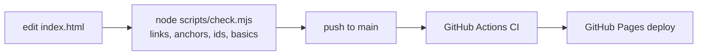

# Portfolio website

[](https://github.com/Madmaxcoder2612/portfolio/actions/workflows/ci.yml)
[](https://madmaxcoder2612.github.io/portfolio/)
[](LICENSE)
[](#limitations)

A single-page dark portfolio for a functional safety and robotics job search. It presents four public learning projects with their headline numbers, the standards being studied, and a clear line between what is used and what is still being learned.

There is no framework, no build step and no dependencies. The whole site is one HTML file, one stylesheet and one script, so it loads fast and cannot break on an `npm install`.

> **Content note.** Every project on the page is a learning project or simulation, and the page says so. Numbers are copied from each project's own README, including the ones that come from assumed models.

## Contents

- [What it does](#what-it-does)
- [Quick start](#quick-start)
- [How it works](#how-it-works)
- [Repository layout](#repository-layout)
- [Editing the content](#editing-the-content)
- [Deploying](#deploying)
- [Limitations](#limitations)
- [Next steps](#next-steps)
- [License](#license)



## What it does

| Feature | Detail |
|---|---|
| Look | An engineering-document style: graphite page, safety yellow, square corners, section numbers (§01, §02 ...), a hazard-stripe divider and a document-control nameplate. No gradients or glow |
| Hero | A technical-drawing grid with a crosshair that shows live X and Y coordinates under the mouse. It only redraws when the mouse moves |
| Scroll | Reveal on scroll, progress bar, active nav link, count-up numbers |
| Cards | Square cards with yellow corner marks, a spotlight that follows the cursor and a soft glow on hover, plus a dashed status stamp |
| Glow | Soft yellow and blue light on interactive things: buttons, nav, cards, chain boxes, chips and the hero crosshair, which also lights the grid under the pointer. Colours are cooler graphite with safety yellow and an orange tint |
| Traceability chain | The hazard-to-test chain from the cobot project, with a "Break the chain" button that shows a failing check (a requirement without a test) in red, and "Repair" to fix it |
| Card graphics | Small bar graphics on each project card, drawn with CSS from numbers in that project's README; they animate in on scroll |
| Safety-zone demo | A toy model of speed and separation monitoring: move a "person" marker towards a robot arm and it slows, then stops. Works with mouse, touch drag and arrow keys |
| Accessibility | Skip link, semantic landmarks, visible focus, real HTML text, keyboard friendly; the demo announces state changes to screen readers |
| Reduced motion | `prefers-reduced-motion` turns off reveals, count-up, the blinking marker, the flowing chain lines and the arm's swing |
| Performance | No libraries; canvases pause when off screen or when the tab is hidden |

## Quick start

```powershell
git clone https://github.com/Madmaxcoder2612/portfolio
cd portfolio
python -m http.server 5173
```

Open <http://127.0.0.1:5173>. Opening `index.html` straight from disk also works in most browsers.

Run the checks (needs Node 18 or newer, nothing to install):

```powershell
node scripts/check.mjs
node --check assets/main.js
```

## How it works

| File | What it does |
|---|---|
| `index.html` | All content and structure |
| `assets/style.css` | Design tokens (colours, fonts), layout, responsive rules, reduced-motion rules |
| `assets/main.js` | Scroll reveal, nav state, count-up, the chain button, the safety-zone demo and the hero grid with crosshair |
| `assets/favicon.svg` | Icon: a yellow square frame |
| `scripts/check.mjs` | Fails if a link or anchor is broken, an id repeats, an image lacks alt text, an external link lacks `rel="noopener"`, placeholder text is left, or the footer lacks the full legal name |
| `.github/workflows/ci.yml` | Runs the checks on every push and pull request, then deploys `main` to GitHub Pages |

## Repository layout

```text
.
├── index.html
├── assets/
│   ├── style.css
│   ├── main.js
│   └── favicon.svg
├── scripts/
│   └── check.mjs
├── .github/workflows/ci.yml
├── LICENSE
└── README.md
```

## Editing the content

- **Add a project:** copy an `<article class="card reveal">` block in the Projects section and change the text, numbers and link.
- **Change colours:** edit the variables at the top of `assets/style.css`.
- **Add a link (for example an email or a new profile):** add an `<a class="btn" href="..." rel="noopener">` in the Contact section. The check script enforces `rel="noopener"` on external links.

## Deploying

The workflow publishes to GitHub Pages. Once, in the repository settings, set **Pages → Build and deployment → Source** to **GitHub Actions**. After that every push to `main` that passes the checks goes live.

## Limitations

- **Fonts are self-hosted** (about 90 KB in total), so no request goes to Google or any other third party. If a font fails to load, the page falls back to system fonts. See [Third-party material](#third-party-material).
- **The checks are structural.** They catch broken links and missing basics, not bad wording or a layout that looks wrong. I checked the visual result by hand in one browser.
- **Project numbers are copied by hand** from the other READMEs. If a project changes, this page can fall out of date.
- **The email address is public on the page** as a plain mailto link, so it can be picked up by spam scrapers. There is no contact form.
- **The safety-zone demo is a picture, not a model.** The zone sizes and the 1.5 m scale are made up for illustration and are not calculated from a stopping-distance analysis; the page says so next to the demo.
- **There is no 3D or WebGL.** The look comes from layout, type and a few small canvases, which keeps the page fast on phones and low-power laptops.

## Next steps

- Add the real-hardware quantum run and any new project cards as they ship.
- Add a short "what I'd do differently" note under each project.
- Decide on an Impressum and a short privacy notice (GitHub Pages logs visitor IP addresses, and the email address is public). I am not a lawyer; a free generator or the Verbraucherzentrale pages are a starting point.
- Add a custom domain.

## License

MIT, see [LICENSE](LICENSE). Copyright (c) 2026 Abhishek Vijay Potekar.

## Third-party material

The page loads nothing from other hosts. All code, text, the favicon and the diagrams are original work under the MIT licence above. `scripts/check.mjs` fails the build if a third-party resource is added.

Two fonts are included in the repo, each under the SIL Open Font License 1.1 (free to use, embed and redistribute, including commercially, as long as the licence text stays with them):

| Font | Files | Licence text |
|---|---|---|
| Inter, copyright 2016 The Inter Project Authors | `assets/fonts/inter-latin-var.woff2` | `assets/fonts/OFL-Inter.txt` |
| JetBrains Mono, copyright 2020 The JetBrains Mono Project Authors | `assets/fonts/jetbrains-mono-latin-var.woff2` | `assets/fonts/OFL-JetBrainsMono.txt` |

The files are the Latin subsets from the `@fontsource-variable` packages, which republish the official releases.

Product and standard names (Qiskit, MATLAB, ISO 13849-1 and so on) are used only to say what I worked with or studied. No text from any standard is reproduced.

> This is a technical statement, not legal advice. A public site in Germany may also need an Impressum and a privacy notice; see Next steps.
